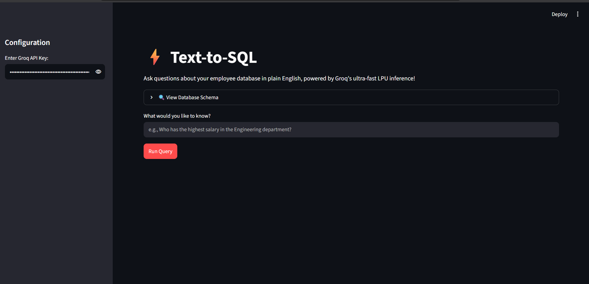

# ⚡ Text-to-SQL App

An intuitive web application that allows users to query an employee database in plain English, powered by **Groq's ultra-fast LPU™ inference engine**. 

 <!-- Replace with your screenshot link if desired -->

---

## 🚀 Features

* **Natural Language to SQL:** Ask complex questions about your database using ordinary, conversational English (e.g., *"Who has the highest salary in the Engineering department?"*).
* **Ultra-Fast Inference:** Leverages Groq APIs for instantaneous response times and seamless query generation.
* **Interactive Database Schema Explorer:** Easily view and inspect the underlying database tables, columns, and relationships directly from the UI.
* **Secure Configuration:** Easily configure and input your Groq API key securely within the application sidebar[cite: 1].
* **Clean UI:** Built with a sleek, user-friendly interface for effortless interaction.

---

## 🛠️ Tech Stack

* **Frontend/UI:** Streamlit (or your framework of choice)
* **LLM Provider:** Groq API (LPU Inference)
* **Database:** SQLite / Relational Database

---
